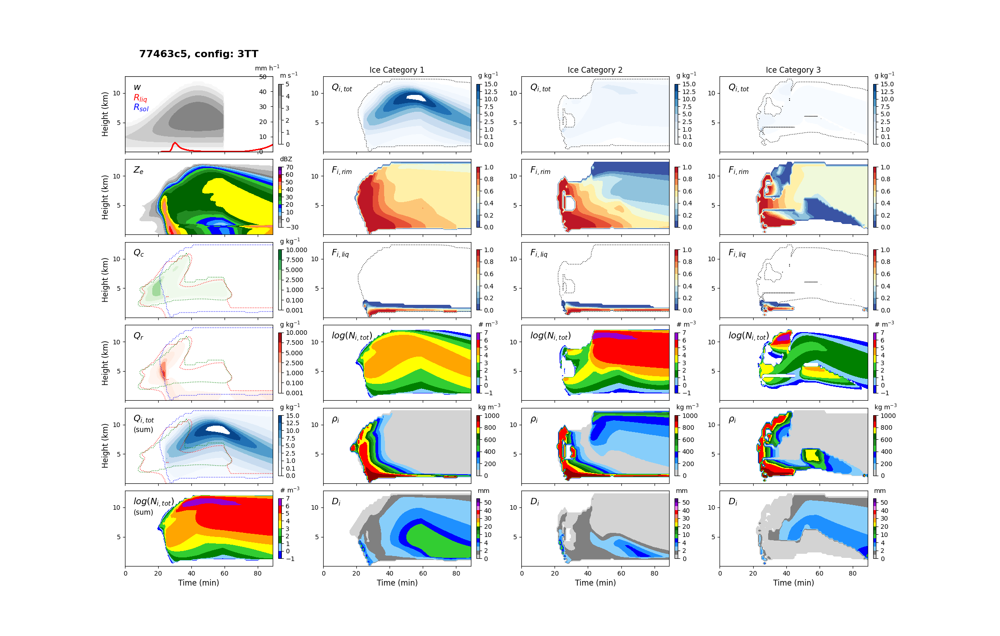
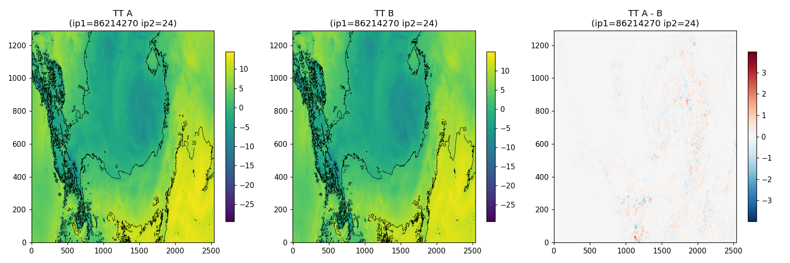
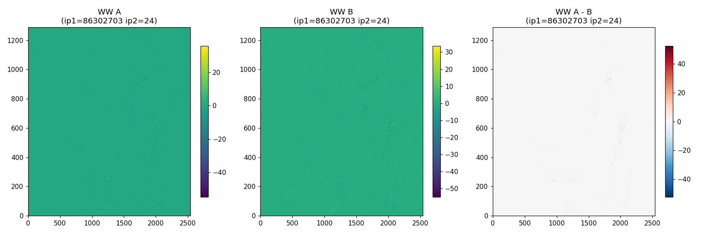
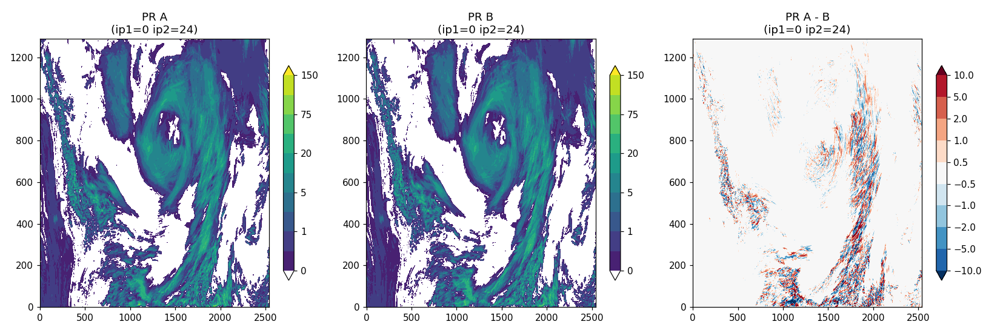

# Test Summary — `jason-cleanup-refactor` branch (→ v5.6.0 target)

**Date:** 2026-07-15
**Branch:** `jason-cleanup-refactor` (commit range `f7b3216`..`27cb2cc`, i.e. everything
since the branch's merge-base with `main`)
**Prepared by:** Jason Milbrandt, with Claude Code
**Scope:** kin1d regression suite (all code-touching commits) + full HRDPS/GEM
verification at operational scale (8 runs, `R001`–`R008`, `gem-notes` project)

---

## Summary

This branch carries roughly seven weeks of refactoring and bug-fixing work on top
of v5.5.1: the generic lerp interpolation engine, LUT named constants, allocatable
LUT arrays, the four-way `sedimentation_ice_*` routine consolidation, and three
confirmed bug fixes (BUG-001 divide-by-zero crash, BUG-003 VIS2 diagnostic overflow,
BUG-004 wrong number-flux at the top sedimenting level). Every commit that touched
`src/microphy_p3.f90` was gated on the kin1d 6-config regression suite — the large
majority bit-identical, with two intentional, individually-validated exceptions
(BUG-004's number-tendency fix, and the LUT2 liquid-fraction blending regression
fix early in the branch's history). Beyond kin1d, the accumulated refactor was
verified twice at full HRDPS/MPI operational scale (1760 PEs): once opportunistically
on a winter case (H22, session 12) and once by design on a second season (E22 summer,
runs R007/R008, full 48 h forecast) — both confirm the refactor is **timing-neutral**
(≤0.6% wall-clock, within machine noise) and **behavior-neutral** (all prognostic
fields show ordinary chaotic-forecast displacement noise, not a systematic bias;
the one real difference, `VIS2`, is the intended BUG-003 fix working correctly).

**Bottom line: PASS.** The branch is ready to merge to `main`, with one open
housekeeping item flagged below (not a code or test defect) that should be resolved
as part of the merge, not after it.

**⚠️ Pre-merge note:** `main` has since advanced independently (commit `f90df96`,
"v5.5.2") with its own copy of the BUG-001 fix, cherry-picked onto a minimal branch
(`bugfix-dum4`) from unmodified v5.5.1. `jason-cleanup-refactor` already contains an
*equivalent* fix (commits `58ea9bd`/`3d6a128`/`1398c26`, same bug, independently
verified — see below) but under different commit hashes, and has not yet merged in
`main`'s v5.5.2 commit. The two fixes are content-equivalent (same root cause, same
guard logic), so this is not expected to be a substantive conflict, but `git merge
main` (or equivalent reconciliation) should be done as an explicit step before or
during the final `/p3-merge-to-main` run, and re-verified with a kin1d
`--compare` pass, rather than assumed to resolve itself.

---

## 1. What's in this branch

Representative commits (see `git log main..jason-cleanup-refactor` for the full
~65-commit list); grouped by theme:

| Theme | Key commits | kin1d gate |
|---|---|---|
| Generic N-D lerp interpolation engine (replacing hand-unrolled LUT interpolation) | `e15e87b`, `35d8d92`, `a2e9a00`, `a61a6ff` (perf fix) | bit-identical (after perf fix) |
| LUT named constants (57 params, 84 call sites) | session 2 commits | bit-identical |
| Allocatable LUT arrays | `367950d` | bit-identical |
| LUT2 liquid-fraction blend regression found + fixed | `67c0f81` | bit-identical vs. always-blend ground truth; intentional diff vs. regressed reference |
| BUG-001 fix (divide-by-zero, `qitot-qiliq → 0`) + residual negative-`qirim` fix | `58ea9bd`, `3d6a128`, `1398c26` | bit-identical (guards inactive in normal operation) |
| Sedimentation routine consolidation (4→1, Option A) | `e723d01` | bit-identical, all 6 configs |
| BUG-003 fix (VIS2 diagnostic overflow, `sedimentation_liquid`) | `f04bb96` | bit-identical (diagnostic-only, prognostics untouched) |
| BUG-004 fix (`flux_qx`→`flux_nx` top-level number tendency) | `6c3987b` | **not** bit-identical (intentional; see §2.2) |
| Review cleanups (F3–F6: stale `tmp1`, magic numbers, itabcolli allocation/docs) | `ef2fc2f`, `95acf21`, `b824b8d` | bit-identical |
| Docs/planning only (no `microphy_p3.f90` changes) | workflow-protocol conversion, testing-protocol plan, p3_main-split plan, LUT-overhaul plan, this branch's `.gitignore`/graphify cleanup | N/A — no kin1d gate required |

Net effect on `src/microphy_p3.f90`: **2,414 insertions / 6,489 deletions** vs.
`main`'s pre-v5.5.2 state (12,882 → ~8,431 lines at the lerp-engine milestone,
with further reductions from the sedimentation consolidation, −406 lines).

Full narrative detail for every commit is in this repo's `CLAUDE.md` Session Log
(sessions 1–15).

---

## 2. kin1d regression testing (Tier 1 — every commit)

All results below are from `kin1d/full_testing/run_full_tests --compare` (exact)
or `--compare-tol` (BUG-004 only), run from `kin1d/src/`, per the protocol in
`kin1d/full_testing/TESTING_PROTOCOL.md`. Standard suite: 6 configs (1FF, 1FT,
1TF, 1TT, 2TT, 3TT), covering all four historical `sedimentation_ice_*` variants
and both 2-mom/3-mom × liquid-fraction interpolation families.

### 2.1 Bit-identical commits

Every commit in the table above marked "bit-identical" reproduced the reference
baseline exactly across all 6 configs (max|Δ| = 0), confirmed before each commit
using the save-reference → compare workflow. This includes the two largest
structural changes on the branch — the lerp engine rewrite and the sedimentation
routine consolidation — both proven behavior-preserving refactors, not just
"probably fine."

### 2.2 Intentional, individually-validated exceptions

**BUG-004** (top-level number-tendency fix) is the one commit expected to — and
does — change results, since it corrects a genuine physics defect (using the mass
flux instead of the number flux for the `nx` update at the top sedimenting level).
Validated via `--compare-tol` across all 6 configs:

- Not bit-identical, as expected.
- Impact small and physically localized: mean `Ze` change **−0.04 dBZ**, median
  **0.00 dBZ**; only ~0.6% of signal-bearing cells change by >1 dBZ, ~0.1% by >5 dBZ.
- Hovmöller plots visually/qualitatively identical before vs. after.

**LUT2 liquid-fraction blend** (`67c0f81`, early in the branch) fixed a regression
introduced by an earlier epsilon-comparison fix (pre-dates this branch's divergence
from `main` in spirit, but the fix itself landed here) that had silently disabled
liquid-fraction blending in ice-ice collection. Validated against an always-blend
ground-truth build (bit-identical) and against the regressed reference (intentional
diffs in 3TT only, consistent with the blend being re-enabled).

### 2.3 Representative output — 3TT config (most demanding: 3 ice categories,
3-moment, liquid fraction), post-sedimentation-consolidation (`e723d01`, the last
commit to touch `src/microphy_p3.f90` on this branch — the working-tree file is
byte-identical to this commit's version):

Clean, physically sensible structure throughout: ice mass/rime-fraction/number/
density fields evolve coherently across all three categories, reflectivity and
precipitation rates behave as expected. No artifacts from the refactor are visible.

### 2.4 Coverage caveat

kin1d hardcodes `scpf_on = .false.` (`cld1d.f90:38`) and is single-column, so it
cannot exercise: SCPF-on configurations (see BUG-002, suspected/untriaged, not
addressed on this branch), or any of the multi-column/MPI-stack-reuse conditions
that produced BUG-001 and BUG-003 in the first place. Both of those bugs were
**GEM-only reproductions** — kin1d passed bit-identical on every commit in their
history, which is exactly why the GEM-scale verification in §3 was necessary
before considering this branch mergeable.

---

## 3. GEM / HRDPS full-scale verification (Tier 2)

Full protocol and run ledger: `gem-notes` project, `RUNS.md` +
`docs/TEST-PROTOCOL.md`; cross-repo workflow: `docs/p3-gem-test-workflow.md`
(this repo). All runs below use the HRDPS `HRnat` case family, GEM base
`5.3.0-b01`, `ptopo 55x32x1` (1760 MPI PEs) unless noted.

### 3.1 Run ledger

| Run | P3 commit | Case | Purpose | Result |
|---|---|---|---|---|
| R001 | `1398c26` | H22 winter, 48h | BUG-001 fix crash-free at HRDPS scale | **PASS** — clean 48h |
| R002 | `f04bb96` | H22 winter, 48h | BUG-003 fix perturbs nothing prognostic | **PASS** — bit-identical @h012 vs. R001 |
| R003 | `6c3987b` | H22 winter, 48h | BUG-004 fix gives only micro-perturbation | **PASS** — TT RMS 0.02 K |
| R004 | `f8c88e9` (`bugfix-dum4`) | H22 winter, 48h | BUG-001 fix crash-free, isolated from refactor | **PASS** — clean 48h |
| R005 | `f7b3216` (unmodified v5.5.1) | E22 summer, 6h | Reproduce BUG-001 on a 2nd season, unfixed baseline | **CRASHED as expected** — SIGFPE INVALID, `find_lookupTable_indices_1a`, confirms the bug is real and reproducible on a different case |
| R006 | `f8c88e9` (`bugfix-dum4`) | E22 summer, 6h | v5.5.2 candidate vs. the R005 crash | **PASS** — clean 6h, same case that crashed R005 |
| R007 | `1398c26` | E22 summer, **48h** | Control for R008: BUG-001-fix-only state, no downstream refactor | **PASS** — clean 48h, GEMDM 4218.3 s |
| R008 | `782ece6` (branch tip, code-equivalent to this doc's `27cb2cc`) | E22 summer, **48h** | Test: full accumulated refactor (sedimentation consolidation + BUG-003 + BUG-004 + review cleanups) vs. R007 | **PASS** — clean 48h, GEMDM 4244.5 s, ratio **1.006** |

### 3.2 The key comparison: R007 vs. R008

R007/R008 is the run pair that most directly answers "does this branch's tip
behave differently from a known-good baseline at full operational scale?" — it is
the only pair in the ledger that (a) isolates the *entire accumulated refactor*
(not just one bug fix) and (b) runs the *full 48h forecast* (not a 6h spinup-only
check), on a season (E22 summer) not covered by the earlier, more incidental H22
timing check (session 12).

**Timing:** GEMDM (GEM's internal wall-clock instrumentation) 4244.5 s (R008) vs.
4218.3 s (R007) — **ratio 1.006**, i.e. +0.6%, within the ±0.6% machine-noise band
already established for this case/topology from the H22 pair (session 12). No cost
regression from the refactor.

**Prognostic comparison** (`tools/fstdiff.py --stats` at h012/h024/h048, fields
`TT,HU,UU,VV,WW` + hydrometeors `MPNC,MPNR,MPQC,MPQR` + `VIS,VIS1,VIS2,VIS3`):
every variable except `VIS2` shows the "small Δmean/Δstd, large RMS" signature —
ordinary chaotic-forecast divergence between two clean runs of a slightly different
model, not a systematic bias. `VIS2` alone flags as a real difference, which is
**expected and correct**: BUG-003 specifically fixed that diagnostic's calculation
(previously reading uninitialized stack garbage at rain-free levels), so a real
change there is the fix working as intended, not a regression.

**Visual confirmation @ h024** (full domain, native HRDPS grid). In each panel
below, A = R007 (control), B = R008 (refactor tip), A−B = difference:

**Temperature (TT, °C):**

**Vertical velocity (WW, native units, σ≈0.7 / z≈3195m):**

**Precipitation rate (PR, mm):**

In all three fields, panels A and B are visually indistinguishable to the eye —
same synoptic pattern, same convective structures, same frontal placement. The
A−B difference panels show only fine-grained, spatially incoherent noise
concentrated at fronts and convective edges (exactly where two otherwise-identical
runs of a chaotic system are expected to diverge first), not a coherent spatial
bias anywhere in the domain. This matches the fstdiff statistical verdict exactly.

### 3.3 Bug reproduction as validation (R005)

R005 deserves a specific callout: rather than only testing that the fix works,
the E22 summer case was also run **without** the fix (plain v5.5.1, commit
`f7b3216`) and it crashed with BUG-001's exact signature (SIGFPE INVALID in
`find_lookupTable_indices_1a`, via `sedimentation_ice`). This is a genuine
negative control — it confirms the bug is real and reproducible on a second,
independent case/season (not just the original H22 report), which makes R006's
clean pass on the identical case meaningfully attributable to the fix itself,
not to some property of the H22 case specifically.

### 3.4 Verdict

**PASS.** The accumulated refactor on `jason-cleanup-refactor` is confirmed
timing-neutral and behavior-neutral (beyond the intended BUG-003 VIS2 fix) at
full HRDPS/MPI operational scale, on two seasons (H22 winter, E22 summer), at
both partial (6h, crash-focused) and full (48h) forecast length. Three
previously-crashing conditions (BUG-001, BUG-003, and the BUG-001-adjacent
overflow found and fixed en route) no longer reproduce.

---

## 4. Known bugs — status at branch tip

Full detail: `KNOWN_BUGS.md`. Summary as of this branch's tip:

| Bug | Status | GEM-verified? |
|---|---|---|
| BUG-001 (divide-by-zero, frozen-mass → 0) | ✅ FIXED | ✅ Yes (R001, R004, R005/R006 reproduction+fix pair) |
| BUG-003 (VIS2 diagnostic overflow) | ✅ FIXED | ✅ Yes (R002, and implicitly every later run) |
| BUG-004 (wrong number flux, top sedimenting level) | ✅ FIXED | ✅ Yes (R003) |
| BUG-002 (suspected SCPF grid-mean/in-cloud accounting) | 🟡 SUSPECTED/UNTRIAGED | N/A — not addressed on this branch; no kin1d coverage exists for `scpf_on=.true.` (see §2.4) |

BUG-002 is not a blocker for this merge — it predates this branch (author's own
in-code `! Note (BUG)` comments), is unconfirmed, and is explicitly out of scope
per the branch's own planning docs (`docs/plans/p3_main-split-plan.md` §10 scope
decision).

---

## 5. Recommendation

Merge `jason-cleanup-refactor` to `main` via `/p3-merge-to-main`, after first
reconciling the `main`-side v5.5.2 commit (`f90df96`) per the pre-merge note in
the Summary above — merge/rebase `main` into this branch, re-run the kin1d
`--compare` gate to confirm the two independent BUG-001 fixes reduce to the same
bit-identical result, then proceed with the merge-to-main skill as normal
(assistant-overlay files stripped, `jason` branch fast-forwarded).

Suggested version bump: **v5.6.0** (crosses the v5.5.x patch-fix line established
by v5.5.2; this branch is a substantial refactor + three bug fixes, not a single
targeted patch).
