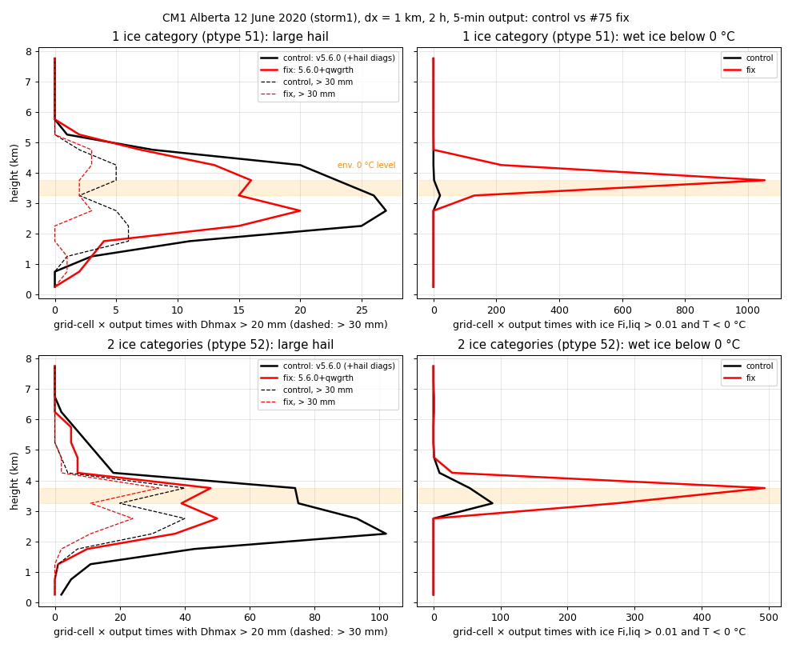
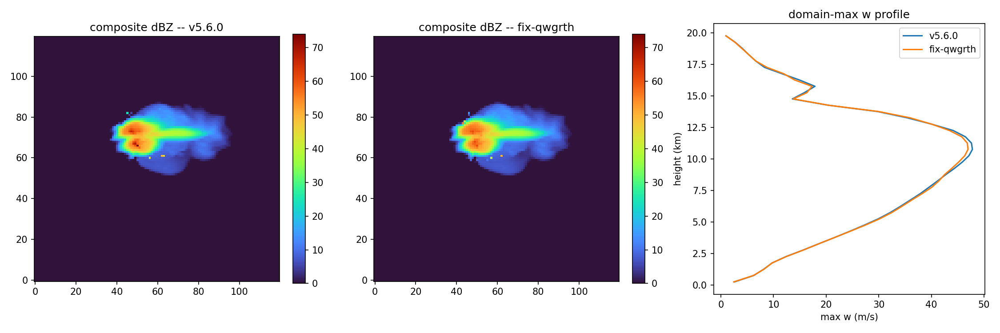
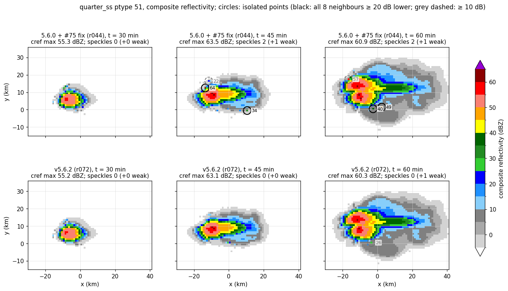
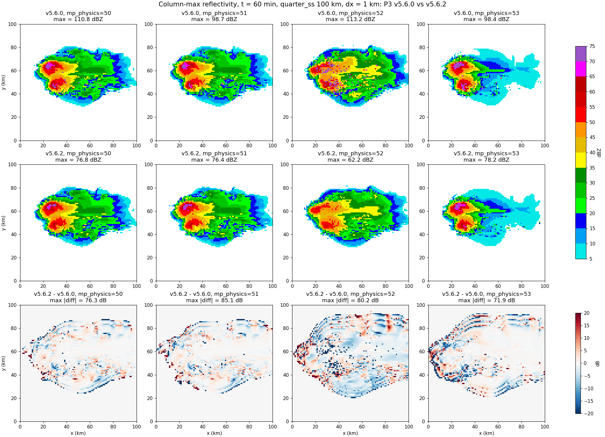
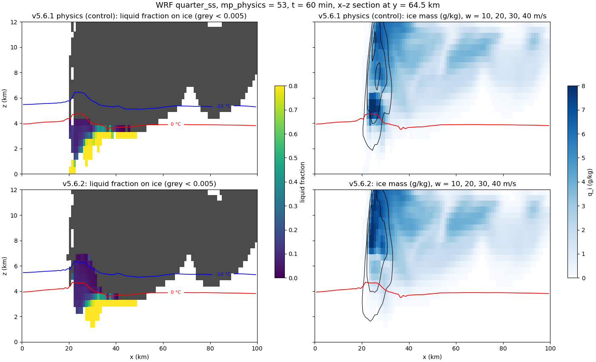

# Test Summary – v5.6.2 (wet-growth fix, `bugfix-qwgrth`)

> Sections 1–4.4 test the branch as developed (5.6.0+qwgrth). §3.4 (kin1d) and §4.5 (CM1) test
> v5.6.2 itself, i.e. the branch merged with v5.6.1, and §5 (WRF) tests v5.6.2 throughout.

**Date:** tests 2026-09-28/29; summary completed 2026-10-01
**Version:** 5.6.2 = v5.6.1 + `bugfix-qwgrth`; merged into `dev` in the commit
"Merge branch 'bugfix-qwgrth'.  New version: v5.6.2" (`f77db6b`); on `main` as `722551b`
**Branch:** `bugfix-qwgrth`, rooted at `dev` 390c9d6 (source identical to v5.6.0)
**Issue:** #75 ("Bug in qwgrth calculation"), closed with v5.6.2; addresses item 1 of #53 ("wet growth and shedding")
**Prepared by:** Jason Milbrandt (kin1d, CM1) and Hugh Morrison (WRF), with Claude Code
**Scope:** kin1d regression suite (every commit) and kin1d timing; CM1 idealized runs (three
control/fix pairs, two cases, one and two ice categories, plus a v5.6.2 rerun); WRF idealized
supercell, four P3 configurations. No GEM runs.

---

## Summary

Since v5.2.0, the wet-growth rate `qwgrth` has been computed with a misplaced parenthesis: the
factor 2π/L_f multiplied only the vapour-diffusion term, so the heat-conduction term κ(T0 − T) was
never divided by the latent heat of fusion. `qwgrth` was therefore about 10⁴ times too large, the
collection rate essentially never exceeded it below 0 °C, and wet growth, the shedding it drives
and wet-growth densification were effectively switched off in every configuration. With liquid
fraction on, collected liquid was never retained on ice below 0 °C. The refreezing rate of retained
liquid, `qifrz`, carried the same parenthesis error, so any liquid on ice below 0 °C refroze
within one time step.

This branch restores the Musil (1970) heat-balance form for `qwgrth` and applies the same heat
balance to `qifrz`, with L_f alone in its denominator (see §2). It also carries a set of
diagnostic-only changes to the precipitation-type and maximum-hail-size diagnostics (§6), merged
from a separate branch so that hail can be diagnosed in CM1.

**Results.** In both host models, wet (liquid-bearing) ice now appears below 0 °C, concentrated
just below the freezing level on the flank of the updraft (CM1: 0 to −5 °C; WRF: mostly 0 to
−10 °C); in v5.6.0 there is none in any run. The upper reflectivity tail is reduced in-core, and
the spurious trace-ice reflectivities of v5.6.0 (BUG-007, fixed in v5.6.1) are gone in CM1 and in
all four WRF configurations. In CM1 the number of large hailstones (> 20–30 mm) below the freezing
level decreases. Storm structure and updraft strength change little in both models. Total
precipitation changes by −2 % to +3 % in CM1 (Alberta, 2 h); in WRF (quarter_ss, 1 h) it falls by
5–12 % in the 1-category configurations and is unchanged (+0.6 %) with 2 categories. In kin1d the
single-category configurations are unchanged at the surface, while the multi-category
configurations respond strongly (2TT 90-min precipitation 3.2 → 9.1 mm); this multi-category
sensitivity does not carry over to CM1 (+3 %) or WRF (+0.6 %). Single-category runs are
timing-neutral; multi-category kin1d runs are 3–6 % slower.

**Bottom line: PASS.** The code behaves as the physics predicts in kin1d and in two host models
(CM1: two cases, one and two ice categories; WRF: four configurations), with no instability, no
spurious reflectivity and no disproportionate response. The larger 1-h precipitation decrease in
WRF is a caveat (§7), not a reason to hold the release. GEM testing is desirable before a release
but was not run.

---

## 1. What's in this branch

| Commit | Change | kin1d (Gate A) |
|---|---|---|
| `d06e050` (+ archive `d49656c`) | `qwgrth` restored to Musil (1970) eq. A9 | tol: 6/6 outside tolerance (expected) |
| `2e0d9f1` (+ archive `72bf8e4`) | `qifrz` heat balance: L_v, denominator L_f | tol: 1FF and 1TF bit-identical (no liquid fraction), 4/6 changed (expected) |
| `0578d71` via merge `21b7679` (+ archive `908b7f3`) | Hail diagnostics: wet-snow rime gate, `qsmall_dhmax`, type diagnostics in CM1 (§6) | exact: 6/6 bit-identical |
| `d330cfb` | Version markers `5.6.0+qwgrth` | exact: 6/6 bit-identical |
| `19c38c8` | kin1d timing archive (§3.3) | – |
| merge into `dev` (v5.6.2) | combined with v5.6.1 (BUG-007 sedimentation fix); version markers 5.6.2 | §3.4, §4.5, §5 |

---

## 2. The bug and the fix

### 2.1 History

Up to v4.5.1 the wet-growth rate followed Musil (1970), eq. (A9). In commit `41110af`
(2022-07-19, v5.0.4 on `dev-liqfrac`, first released in v5.2.0) `qwgrth` was replaced by a copy
of the liquid-fraction refreezing rate `qifrz` ("qwgrth is now equal to qifrz (not using Musil
1970)"). `qifrz` already contained the parenthesis error, so from v5.2.0 both rates were wrong.

### 2.2 `qwgrth` (wet growth)

```
v5.2.0–v5.6.0:  f · [ κ(T0 − T) + ρ L_s D_v (q_s0 − q_v) · 2π / L_f ] · N
this branch:    f · 2π [ ρ L_v D_v (q_s0 − q_v) + κ(T0 − T) ] / [ L_f + c_w (T − T0) ] · N
```

(`f` is the ventilation factor.) The restored form is the heat-balance limit on the rate at which
collected supercooled water can freeze while the particle surface stays at 0 °C: latent heat is
removed by conduction to the air and by evaporation from the wet surface (L_v, since the surface is
liquid). Collected water at T < 0 °C must first be warmed to 0 °C, absorbing c_w(T0 − T) per kg,
so the net heat per kg frozen is L_f + c_w(T − T0). That term is valid here because wet growth is
defined at the point where the frozen flux equals the collected flux.

### 2.3 `qifrz` (refreezing of liquid on ice)

```
v5.2.0–v5.6.0:  f · [ κ(T0 − T) + ρ L_s D_v (q_s0 − q_v) · 2π / L_f ] · N
this branch:    f · 2π [ ρ L_v D_v (q_s0 − q_v) + κ(T0 − T) ] / L_f · N
```

Same numerator as `qwgrth`. The denominator is L_f alone: `qifrz` freezes liquid that is already
on the particle at about 0 °C (retained or melted water), which brings no cold with it. The cold
carried by freshly collected supercooled water scales with the collection rate, not the freezing
rate, so it does not belong in this denominator. With the c_w term the refreezing rate would be
overstated by L_f / (L_f − c_w|T − T0|): 7 % at −5 °C, 14 % at −10 °C, 34 % at −20 °C. This
choice was discussed and agreed by Jason Milbrandt and Hugh Morrison. As a consequence, in the
liquid-fraction scheme the cold carried by collected water is not counted in any process.

### 2.4 Expected effect

Wet growth is possible again. It occurs most readily just below 0 °C, where the heat-removal
limit is smallest, and becomes rarer as the air gets colder. Liquid above the wet-growth limit is
retained on the ice (liquid fraction on) or shed (liquid fraction off) instead of freezing at the
full collection rate.

---

## 3. kin1d

### 3.1 Surface precipitation (90 min)

| Config | v5.6.0 | + `qwgrth` fix | + `qifrz` fix (branch) |
|---|---|---|---|
| 1FF | 57.23 mm | 57.30 | 57.30 |
| 1FT | 55.47 | 55.51 | 55.51 |
| 1TF | 43.88 | 43.90 | 43.90 |
| 1TT | 43.31 | 43.32 | 43.32 |
| 2TT | 3.20 | 10.68 | 9.12 |
| 3TT | 4.23 | 10.69 | 14.32 |

In the single-category configs the surface total is unchanged; the partition shifts toward
solid (1FF peak solid rate 9.15 → 11.70 mm h⁻¹), and ice density, rime fraction and N_i change.
The multi-category configs respond strongly, and are sensitive to small changes: the same `qifrz`
with the c_w term (not committed) gave 2TT 19.48 mm and 3TT 15.14 mm, so a 7–14 % change in
`qifrz` halves 2TT precipitation. The kin1d multi-category surface total is therefore not a robust
metric for this change; neither CM1 (§4.3) nor WRF (§5.4) shows the same sensitivity.


: kin1d 2TT, v5.6.0 (first) and this branch (second). With the fix, liquid fraction appears on
ice aloft and category 1 grows large, dense rimed ice.

### 3.2 Gate A record

Every commit touching `src/microphy_p3.f90` was run against a reference taken immediately before
it (§1). The diagnostic-only and version-marker commits are bit-identical in all six configs, and
the `qifrz` commit is bit-identical in the two configs without liquid fraction, as expected since
`qifrz` is only active with liquid fraction.

Note: `compare_runs.py --compare-tol` printed "Result: ALL PASS" in its summary line even though
every config was reported as FAIL above it (a numpy boolean compared with `is False`). The
tolerance verdicts here were read from the per-config lines.

### 3.3 Timing

Interleaved A/B, `-O2`, 8 runs per build per config, against `dev` (source identical to v5.6.0).
Archive and full table: `kin1d/tests/results-d330cfb/timing/`.

| Config | Δ mean | Δ min | run-to-run SD |
|---|---|---|---|
| 1FF | −2.0 % | −0.4 % | ~5 % |
| 1FT | +0.9 % | +1.8 % | ~4 % |
| 1TF | −0.8 % | −0.8 % | 3–7 % |
| 1TT | +0.3 % | +0.4 % | 5–6 % |
| 2TT | +5.6 % | +3.9 % | ~2 % |
| 3TT | +3.2 % | +5.1 % | ~3 % |

Single-category configs are timing-neutral. The multi-category configs are 3–6 % slower; since
the code change adds only a few operations per wet-growth point and those solutions change
strongly (§3.1), the extra cost most likely reflects more points with active rain and ice rather
than the formulas themselves. This test cannot separate the two.

### 3.4 Merge with v5.6.1 (5.6.2)

The branch was rooted before v5.6.1. The merged `src/microphy_p3.f90` differs from the branch
tip only in the version markers and the v5.6.1 change (the `nit >= nsmall` condition removed
from the ice-sedimentation gate, BUG-007); the only merge conflicts were the version lines.

kin1d, 5.6.2 against the branch tip (5.6.0+qwgrth), exact mode, Mac, 2026-09-29:

| Config | Result | Values differing (exact) | Outside tolerance (rtol 0.01, atol 1e-7) |
|---|---|---|---|
| 1FF, 1FT, 1TT, 3TT | bit-identical | 0 | 0 |
| 1TF | differs | 190 of 84 870 | 45 |
| 2TT | differs | 181 of 114 390 | 38 |

These are the configurations in which the BUG-007 gate fires, as in the v5.6.1 test
(`test-summaries/20260929-v5.6.1-nitotsedi-bugfix/`). The differences are at trace ice: 90-min
surface precipitation changes by 3e-6 (relative) in 1TF and not at all in 2TT, and the largest
reflectivity difference is 0.02 dBZ. The two fixes therefore do not interact measurably in
kin1d, and the §3.1 results carry over to 5.6.2.

---

## 4. CM1

CM1 r21.1, P3 interface as distributed in `interfaces/cm1/cm1_r21.1/`, only `module_mp_p3.F`
differing between control and fix. All runs dx = dy = 1 km on a Mac (x86_64 gfortran 14.2).
Controls use v5.6.0 physics (with the §6 diagnostics for the Alberta runs).

| Pair (control / fix) | Case | ptype | Length | Clean? |
|---|---|---|---|---|
| r032 / r044 | quarter_ss (Weisman–Klemp supercell, 120 × 120 × 40) | 51: 1 ice cat, 3-mom, liquid fraction | 1 h | yes (CFL ≤ 0.96, no NaN) |
| r068 / r069 | Alberta 12 June 2020, `storm1` sounding (200 × 200 × 40, translating grid) | 51 | 2 h | yes |
| r070 / r071 | Alberta 12 June 2020 | 52: 2 ice cats, 3-mom, liquid fraction | 2 h | yes |

Also r066 / r067: Alberta 1 h, v5.6.0 without and with the §6 diagnostics (a tripwire: all 20
prognostic and accumulated fields bit-identical at all 13 output times); and r072: quarter_ss
with v5.6.2 (§4.5).

### 4.1 Wet hail

Ice with liquid fraction > 0.01 below 0 °C:

- **quarter_ss.** v5.6.0: none at any output time, including the rimed-growth region (w > 10 m s⁻¹,
  supercooled cloud + rain > 1 g kg⁻¹, ice density > 700 kg m⁻³); the largest liquid fraction
  anywhere below 0 °C is 0.007. Fix: at 60 min, 88 of 123 growth-region points between 0 and
  −5 °C are wet (liquid fraction up to 0.78), 19 of 152 between −5 and −10 °C (up to 0.26), 2 of
  269 between −10 and −20 °C, none colder.
- **Alberta, grid-cell × output times over 2 h:** 1 category 23 → 1400; 2 categories 152 → 798.
  Concentrated between 3.25 and 4.25 km, just above the environmental 0 °C level (~3.5 km).


: quarter_ss, t = 45 min, x–z section at y = 6.5 km through the wettest sub-0 °C ice of the fix
run; v5.6.0 (r032, top) and fix (r044, bottom). Panels as below. In v5.6.0 liquid-bearing ice
ends at the 0 °C line; with the fix it extends about 1–1.5 km above it, toward the −10 °C
isotherm, on the updraft flank where supercooled liquid (green) and dense rimed ice meet.


: quarter_ss, t = 60 min, x–z section through the updraft (same row in both runs). Left: liquid
fraction on ice (grey: < 0.005); red line 0 °C. Middle: ice mass, w (black) and supercooled
liquid (green). Right: ice density. With the fix, wet ice extends from the freezing level to about
6.3 km (0 to −10 °C) on the west flank of the updraft, where supercooled liquid and dense rimed
ice coincide; storm structure is otherwise nearly identical.

### 4.2 Hail size and reflectivity

- **quarter_ss.** The upper reflectivity tail is reduced in-core (not by isolated grid-cell
  spikes): at 60 min, 99.9th percentile of points > 40 dBZ 67.9 → 60.4 dBZ, points > 60 dBZ 30 → 3,
  while the > 50 dBZ area is unchanged (709 vs 715 points). Rain mass +4.7 %, ice mass −0.8 %, peak
  w −0.9 m s⁻¹.
- **Alberta.** The largest diagnosed sizes aloft (~60 mm at 3.75–4.25 km for 1 category) are
  similar in control and fix, but fewer stones exceed 20–30 mm below the freezing level: at 2.25 km,
  cell-times with D_hmax > 20 mm 25 → 15 (1 cat) and 102 → 37 (2 cat); at 1.75 km 11 → 4 and
  43 → 10.


: Alberta, 2 h: grid-cell × output times with D_hmax > 20 mm (solid) and > 30 mm (dashed), and with
wet ice below 0 °C, control (black) vs fix (red), for 1 and 2 ice categories. Shading: environmental
0 °C level.


: quarter_ss, 60 min: composite reflectivity (v5.6.0, fix) and domain-maximum w profile.

### 4.3 Precipitation and multi-category response

| Pair | Total precipitation at 2 h | Max accumulated precipitation |
|---|---|---|
| Alberta, 1 cat | 14.9 → 14.6 Mt (−2 %) | 2.72 → 2.53 cm |
| Alberta, 2 cat | 12.3 → 12.7 Mt (+3 %) | 2.06 → 2.00 cm; category-2 ice mass +14 % |

The large multi-category response seen in kin1d (§3.1) is not reproduced in CM1.

### 4.4 Surface hail

Neither case produces meaningful surface hail with either version: in both soundings the hail melts
before reaching the ground (Alberta: 0 °C near 3.5 km over a 21.5 °C surface; surface ice is 90–99 %
liquid by mass, accumulated solid precipitation ≤ 0.024 cm). The effect of the fix on surface hail
swaths therefore remains untested; a case with a lower freezing level is needed.

### 4.5 v5.6.2 (r072)

The runs above use the branch (5.6.0+qwgrth), which lacks the v5.6.1 sedimentation fix (BUG-007).
quarter_ss was rerun with v5.6.2 (`722551b`) as r072: same namelist, CM1 build and compiler as
r044, only `module_mp_p3.F` differing. Clean (no NaN, CFL ≤ 0.98).

| quarter_ss, 60 min | v5.6.0 (r032) | branch (r044) | v5.6.2 (r072) |
|---|---|---|---|
| 3D reflectivity max (dBZ) | 74.0 | 60.9 | 60.3 |
| 99.9th percentile of points > 40 dBZ | 67.9 | 60.4 | 59.9 |
| Points > 60 dBZ | 30 | 3 | 2 |
| Points > 50 dBZ | 709 | 715 | 716 |
| Isolated trace-ice points, all 5 outputs | 5 | 8 | 0 |

- **Against the branch (r044)**, cloud, rain and ice mass change by less than 0.1 % and peak w by
  +0.6 m s⁻¹, so the §4.1–4.2 results hold for v5.6.2. Wet ice in the rimed-growth region at
  60 min: 85 of 124 points between 0 and −5 °C, 19 of 153 between −5 and −10 °C, 2 of 271 between
  −10 and −20 °C. The same script gives 90/127, 18/153 and 2/267 for r044 (§4.1 records 88/123
  from an earlier count).
- **BUG-007 speckles removed.** Isolated points are counted in 3D reflectivity as points ≥ 20 dBZ
  whose eight horizontal neighbours are all at least 20 dB lower. In r032 and r044 they are trace
  ice (≤ 4e-6 kg kg⁻¹, D_m 35–55 mm) at up to 65 dBZ; r072 has none. In composite reflectivity
  r072 keeps one weak point of the same signature (26 dBZ at 60 min and 5.75 km), found only with a
  10-dB neighbour test. This type of point comes from ice size sorting during sedimentation, a
  known limitation present in all versions (BUG-005), not from BUG-007.
- **Against v5.6.0 (r032)**, the whole change: rain mass +4.7 %, ice mass −0.8 %, cloud mass
  −0.7 %, peak w −0.3 m s⁻¹.
- **D_hmax** (first CM1 output of it on this case): max 19 mm at 45 min (4.25 km), 25 mm at 60 min
  (5.75 km), ≤ 8 mm at the lowest level.

The Alberta pairs were not rerun with v5.6.2: kin1d (§3.4) and r072 both show that the two fixes
do not interact measurably.


: quarter_ss composite reflectivity at 30, 45 and 60 min, branch (r044, top) and v5.6.2 (r072,
bottom). Circles mark isolated points: black, all eight neighbours at least 20 dB lower; grey
dashed, at least 10 dB lower. The r044 points at 45 and 60 min are BUG-007 trace ice; r072 has
none by the 20-dB test.

---

## 5. WRF

WRF idealized supercell (quarter_ss), four P3 configurations (mp_physics = 50–53), 1 h, run by
Hugh Morrison on NCAR Derecho. Each configuration was run with v5.6.2 and with the released
v5.6.0, and two of them (50 and 53) also with v5.6.1 physics, which separates the wet-growth fix
from the BUG-007 fix. All 12 runs complete with no NaN.

### 5.1 Setup

- **WRF:** workspace `wrf_p3_v5.6.0_git` (fork `hmorrison100/WRF`, branch `p3_v5.6.0`, HEAD
  `b198913`, "quarter_ss: center warm bubble at x = 20 km, y = domain center"). The P3 WRF
  interface changes are uncommitted in that workspace (`Registry.EM_COMMON`, `solve_em.F`,
  `module_microphysics_driver.F`, `module_physics_init.F`). They were last edited before the first
  build and are the same in every build, so the only file that differs between builds is
  `phys/module_mp_p3.F`.
- **P3 source:** `phys/module_mp_p3.F` for v5.6.2 is byte-identical to `src/microphy_p3.f90` at
  `f77db6b` (identical on `main` `722551b`). The controls are copies kept in the WRF workspace
  under `p3_versions/`:

  | Label | P3 file | Relation to this repo |
  |---|---|---|
  | v5.6.0 | `module_mp_p3.F.v5.6.0` | released v5.6.0 (identical to v5.6.1 except the version lines and the BUG-007 gate) |
  | v5.6.1 physics | `module_mp_p3.F.v5.6.0_nonitgate` | v5.6.0 with the `nit >= nsmall` gate removed; identical to v5.6.1 (`0c87e1b`) except version lines and comments |
  | v5.6.2 | `module_mp_p3.F.v5.6.2` | `f77db6b` |

- **Build:** `./compile em_quarter_ss`, Intel ifx 2025.2.1 (`ncarenv/25.10`), cray-mpich 8.1.32,
  `-O3 -fp-model precise`, PBS (`develop`, 2 cores, 40 GB). Build logs `compile_p3v560_b.log`
  (the first v5.6.0 attempt, `compile_p3v560.log`, ran out of memory in RSL_LITE),
  `compile_p3v560_nonitgate.log` and `compile_p3v562.log`. All builds reported "Executables
  successfully built".
- **Case:** `em_quarter_ss` Weisman–Klemp supercell, 101 × 101 × 41 points, Δx = 1 km, Δt = 6 s,
  60 min, output every 30 min, warm bubble at x = 20 km. Namelists and soundings are identical
  across versions for each configuration.
- **Runs:** PBS `develop`, 8 MPI tasks, one node. Directories under `wrf_p3_v5.6.0_git/test/`:
  `p3v560_mp5{0,1,2,3}_dx1km_100km` (2026-09-28), `p3v560nonit_mp5{0,3}_dx1km_100km`
  (2026-09-28), `p3v562_mp5{0,1,2,3}_dx1km_100km` (2026-09-29).

| mp_physics | P3 configuration | Liquid fraction | Affected by |
|---|---|---|---|
| 50 | 1 ice category, 2-moment ice, fixed N_c | off | `qwgrth` (wet growth → shedding) |
| 51 | as 50, prognostic N_c | off | `qwgrth` |
| 52 | 2 ice categories, prognostic N_c | off | `qwgrth` |
| 53 | 1 ice category, 3-moment ice, liquid fraction, prognostic N_c | on | `qwgrth` and `qifrz` |

All 12 runs end with "SUCCESS COMPLETE WRF", and no rsl file contains NaN. None of the v5.6.2 runs
is expected to be bit-identical to a control, since `qwgrth` is active in every configuration.

### 5.2 Reflectivity (BUG-007 and wet growth)

3D `REFL_10CM`, t = 60 min (30 min in brackets). "A40" is the area with column-maximum ≥ 40 dBZ;
"p99.9" is the 99.9th percentile over points > 40 dBZ.

| mp | Version | Max dBZ | Points > 80 dBZ | Points > 70 dBZ | A40 (km²) | A50 (km²) | p99.9 |
|---|---|---|---|---|---|---|---|
| 50 | v5.6.0 | 110.8 (105.0) | 7 (2) | 67 | 504 | 226 | 102.1 |
| 50 | v5.6.1 physics | 73.5 (71.0) | 0 (0) | 63 | 489 | 219 | 73.1 |
| 50 | v5.6.2 | 76.8 (74.9) | 0 (0) | 26 | 489 | 213 | 74.6 |
| 51 | v5.6.0 | 98.7 (71.1) | 9 (0) | 54 | 483 | 222 | 88.9 |
| 51 | v5.6.2 | 76.4 (73.9) | 0 (0) | 33 | 472 | 202 | 74.7 |
| 52 | v5.6.0 | 113.2 (113.9) | 83 (30) | 108 | 666 | 265 | 112.1 |
| 52 | v5.6.2 | 62.2 (58.2) | 0 (0) | 0 | 540 | 133 | 58.3 |
| 53 | v5.6.0 | 98.4 (78.5) | 4 (0) | 119 | 401 | 210 | 81.3 |
| 53 | v5.6.1 physics | 79.2 (85.2) | 0 (2) | 127 | 401 | 196 | 78.0 |
| 53 | v5.6.2 | 78.2 (74.1) | 0 (0) | 28 | 377 | 182 | 75.3 |

- **BUG-007.** The v5.6.0 outliers (> 80 dBZ) are removed by the v5.6.1 fix alone (mp 50, 53).
  The results for mp 50 and 53 match the v5.6.1 bisection
  (`test-summaries/20260929-v5.6.1-nitotsedi-bugfix/`, §2). mp 51 and 52 were not run with v5.6.1
  physics, so for them the two fixes cannot be separated. The 2-category run (mp 52) was the worst
  affected, with speckles throughout the anvil and forward flank (figure below). Some of its
  A40/A50 decrease (666 → 540 km², 265 → 133 km²) is probably the removal of these speckles.
- **Wet growth.** Beyond the BUG-007 fix, v5.6.2 reduces the upper reflectivity tail: points
  > 70 dBZ drop 63 → 26 (mp 50) and 127 → 28 (mp 53) relative to v5.6.1 physics. The > 40 dBZ area
  is unchanged for mp 50 and 6 % smaller for mp 53. This is the same in-core reduction of the tail
  seen in CM1 quarter_ss (§4.2).
- In the mp 53 v5.6.1-physics run, 2 points exceed 80 dBZ at 30 min (max 85.2 dBZ). They are gone
  by 60 min and are absent in v5.6.2. They were not examined. The v5.6.1 summary attributes 3-moment
  points > 75 dBZ in that configuration to hail, not to BUG-007.


: WRF column-maximum reflectivity at 60 min, v5.6.0 (top), v5.6.2 (middle) and the difference
(bottom), for mp_physics = 50–53. The v5.6.0 speckles (magenta/purple, most visible for mp 52) are
BUG-007. The large "max |diff|" values come from echo edges and from those speckles, not from
shifts in the storm cores.

### 5.3 Wet ice below 0 °C (mp_physics = 53)

Grid points with q_i > 1e-5 kg kg⁻¹ and liquid fraction q_il/q_i > 0.01 at T < 0 °C, given as
wet / all ice points in each band:

| T band | v5.6.0 | v5.6.1 physics | v5.6.2, 30 min | v5.6.2, 60 min |
|---|---|---|---|---|
| 0 to −5 °C | 0 / 1048 | 0 / 1024 | 64 / 286 | 173 / 1017 |
| −5 to −10 °C | 0 / 1552 | 0 / 1536 | 26 / 403 | 101 / 1577 |
| −10 to −20 °C | 0 / 4180 | 0 / 4147 | 13 / 933 | 49 / 4203 |
| below −20 °C | 0 / 35762 | 0 / 35755 | 0 / 6049 | 0 / 35431 |
| max liquid fraction below 0 °C | 0 | 0 | 0.84 | 0.90 |

(Control columns at 60 min.) As in CM1 (§4.1), wet ice below 0 °C is absent in the controls. With
the fix it appears and is concentrated just below 0 °C, becoming rarer with colder air, as the heat
balance predicts (§2.4). The domain-total liquid on ice changes little (0.178 → 0.171 Mt at
60 min), since most of it is in melting ice below the freezing level.


: WRF mp_physics = 53, t = 60 min, x–z section at y = 64.5 km (the row with the most wet ice below
0 °C in v5.6.2). Top: v5.6.1 physics, bottom: v5.6.2. Left: liquid fraction on ice (grey:
< 0.005), 0 °C (red) and −10 °C (blue). Right: ice mass, w = 10–40 m s⁻¹ (black), 0 °C (red). With
v5.6.1 physics, liquid-bearing ice ends at the 0 °C line. With the fix, it extends from the
freezing level to about 7 km (below −10 °C) in the updraft at x ≈ 22–30 km. Storm structure is
otherwise nearly the same.

### 5.4 Mass budget and precipitation

t = 60 min. Masses are domain integrals in Mt. "Precipitation" is the domain sum of `RAINNC`
(all surface precipitation). Changes are v5.6.2 relative to v5.6.1 physics where available,
otherwise relative to v5.6.0.

| mp | Control | Rain mass | Ice mass | Surface precipitation | Max accumulation (mm) | Peak w (m s⁻¹) | Mean ρ_i, q_i > 0.1 g/kg |
|---|---|---|---|---|---|---|---|
| 50 | v5.6.1 phys. | 3.31 → 3.80 (+15 %) | 19.9 → 19.8 | 5.60 → 5.27 (−5.9 %) | 52.2 → 54.7 | 49.8 → 47.9 | 471 → 476 |
| 51 | v5.6.0 | 3.29 → 3.76 (+14 %) | 19.9 → 19.7 | 5.53 → 5.23 (−5.5 %) | 50.1 → 52.9 | 52.5 → 51.8 | 484 → 489 |
| 52 | v5.6.0 | 2.05 → 2.25 (+10 %) | 24.1 → 23.6 | 3.19 → 3.21 (+0.6 %) | 42.5 → 37.7 | 48.8 → 46.5 | 360 → 387 |
| 53 | v5.6.1 phys. | 3.17 → 3.46 (+9 %) | 19.7 → 20.2 (+2.6 %) | 5.19 → 4.59 (−11.6 %) | 53.2 → 51.8 | 48.8 → 48.3 | 498 → 500 |

- The BUG-007 fix alone changes these quantities by under 1 % (mp 50 and 53: v5.6.0 vs v5.6.1
  physics), so the changes above come from the wet-growth fix.
- Rain mass rises in every configuration, as expected: without liquid fraction, liquid above the
  wet-growth limit is shed as rain. Mean ice density rises slightly (up to +27 kg m⁻³, with 2
  categories).
- Surface precipitation at 1 h falls by 5–12 % in the 1-category runs, while rain mass aloft rises.
  This suggests the extra rain has not yet reached the ground by 1 h, but a 1-h run cannot show
  that. The decrease is larger than CM1's −2 % (Alberta, 1 category, 2 h; §4.3). A 2-h WRF run
  would show whether it persists.
- Surface solid precipitation (mp 53, `SNOWNC`) is small in both runs and decreases: 0.042 →
  0.011 Mt, max 3.5 → 2.3 mm (0.8 % → 0.25 % of the total). As in CM1 (§4.4), this sounding melts
  nearly all ice before the ground, so surface hail remains untested.

---

## 6. Hail diagnostics carried by this branch (`0578d71`, diagnostic-only)

- Precipitation-type classification: the wet-snow class now requires low rime
  (`liq_frac ≥ 0.15 .and. rime_frac < 0.6`). Previously any ice with `liq_frac ≥ 0.15` was
  classified as wet snow, so melting rimed hail was never classified as hail and never sized.
  The same change was tested and adopted in GEM.
- `diag_dhmax` is computed only where `qitot ≥ qsmall_dhmax = 1.e-6` kg kg⁻¹ (as adopted in GEM).
- The type-diagnostic block, which computes `diag_dhmax`, now also runs for CM1 (it ran only for
  GEM and kin1d, so the CM1 hail-size output was always zero), every time step
  (`freq3Ddiag_cm1 = 0`).
- `log_outputStep` no longer evaluates `mod(x, 0.)` when `freq3Ddiag = 0`.

kin1d is bit-identical (6/6), and CM1 prognostics are bit-identical (r066 vs r067). These
diagnostics are not exercised in WRF (§7).

---

## 7. Open items and caveats

- **WRF precipitation at 1 h.** The 1-category WRF runs lose 5–12 % of surface precipitation while
  rain mass aloft rises 9–15 % (§5.4), more than the −2 % to +3 % seen in CM1 (Alberta, 2 h). The
  extra rain may not have reached the ground by 1 h; a 2-h WRF run (at least mp_physics 50 and 53)
  would show whether the decrease persists.
- **No v5.6.1-physics WRF runs for mp_physics 51 and 52**, so for these the BUG-007 and wet-growth
  effects are not separated (§5.2, §5.4).
- **Hail diagnostics not exercised in WRF.** The WRF driver does not pass `diag_dhmax` or the
  precipitation-type diagnostics to WRF output, and `HAILNC` is not filled by P3 (zero in all
  runs). The §6 changes are therefore tested in kin1d and CM1 only.
- **WRF interface not committed.** The WRF-side P3 interface changes (§5.1) are uncommitted in the
  WRF workspace; a patch backup is kept beside the P3 clone on Derecho
  (`wrf_p3_v5.6.0_uncommitted_20260929.patch`). `phys/module_mp_p3.F` there now holds v5.6.2.
- **Alberta CM1 pairs not rerun with v5.6.2** (§4.5).
- **#53 items 2 and 3** (deactivating refreezing during wet growth; limiting shedding of all
  `qiliq` in one step) are separate problems and remain open.
- **No GEM runs.** Desirable before a release; the operational GEM build traps floating-point
  exceptions, but the new denominators (L_f, and L_f + c_w(T − T0) above −79 °C) cannot reach zero
  where they are evaluated.
- **Surface hail untested** in either host model (§4.4, §5.4).
- **Found during testing, not changed here:**
  - CM1 interface `solve3.F`: the "translated" solid-precipitation swath `hail2` is never
    translated (no `movesfc` call), so it equals `hail`.
  - The P3 call in CM1's `mp_driver.F` is not OpenMP-parallel, so microphysics (over half the run
    time) runs on one thread.
  - In the 2-category Alberta runs, D_hmax reaches exactly 150 mm at 3.75–4.25 km in both control
    and fix; probably an upper bound in `maxHailSize`.
  - WRF `Registry.EM_COMMON`: the DFI package for mp_physics = 53 (`p3_1cat_3mom_dfi`) omits `qil`
    and `qnc`, which the non-DFI package includes. This matters only if DFI is used.

---

## 8. Recommendation

`bugfix-qwgrth` was merged into `dev` as v5.6.2 (`f77db6b`; issue #75, #53 item 1) and promoted to
`main` (`722551b`). v5.6.2 passes the kin1d, CM1 and WRF tests and is recommended for the public
repository. The WRF copy of P3 (`phys/module_mp_p3.F` in the WRF workspace) is at v5.6.2.
