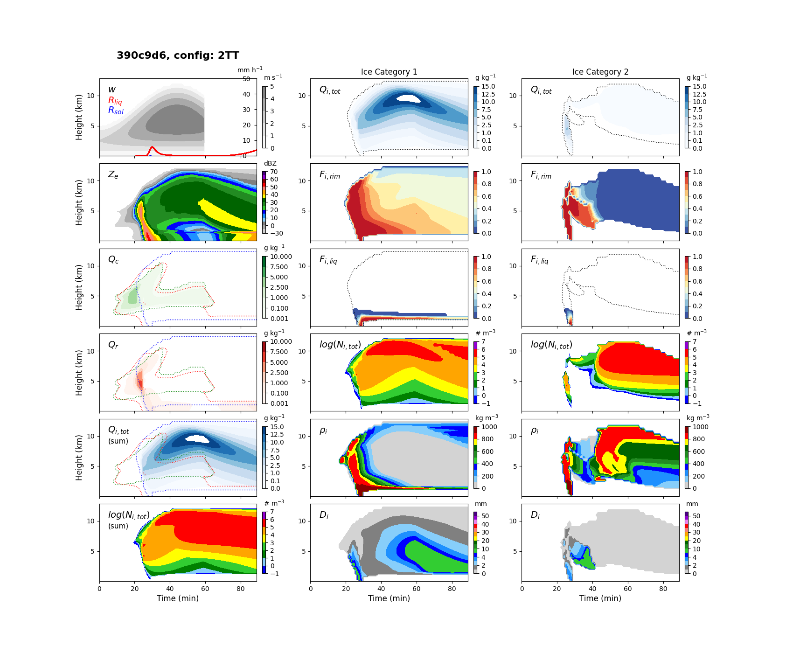
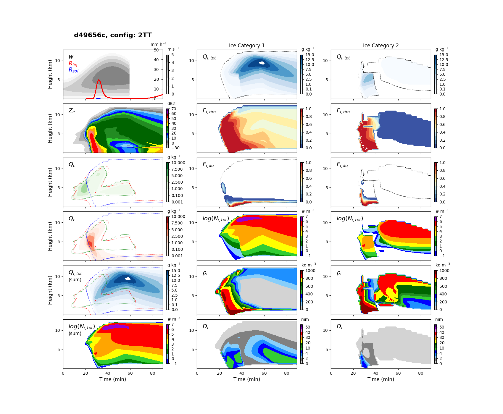
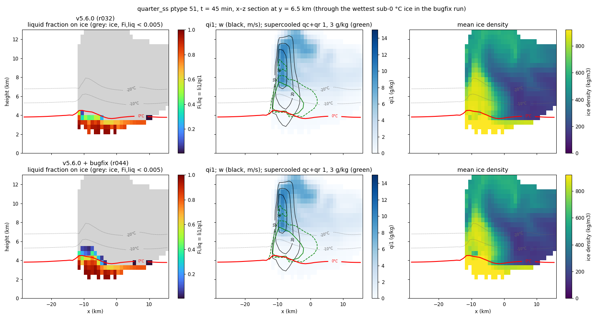
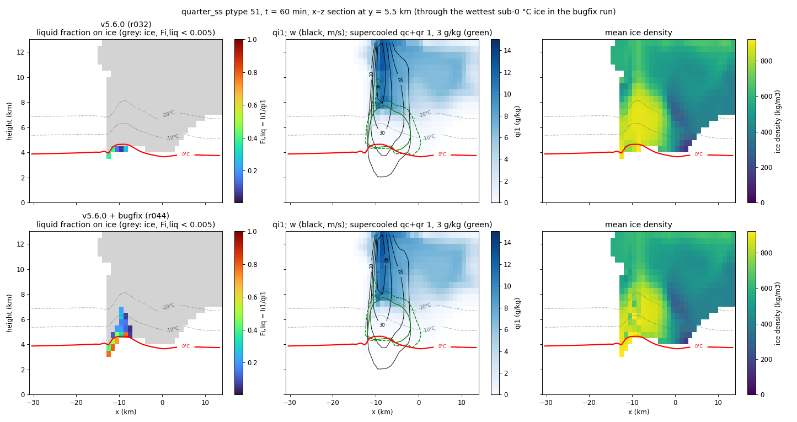

# Test Summary – v5.6.2 (wet-growth fix, `bugfix-qwgrth`) – PRELIMINARY

> **Preliminary.** Written at the merge into `dev`. CM1 test runs are still in progress and
> Hugh Morrison will test the code in WRF; this summary will be updated with both before v5.6.2
> is promoted to `main`. Sections 1–5 describe the branch as tested (5.6.0+qwgrth); §3.4
> covers the merge with v5.6.1.

**Date:** 2026-09-29 (preliminary)
**Version:** 5.6.2 = v5.6.1 + `bugfix-qwgrth`; merged into `dev` in the commit
"Merge branch 'bugfix-qwgrth'.  New version: v5.6.2"
**Branch:** `bugfix-qwgrth`, rooted at `dev` 390c9d6 (source identical to v5.6.0)
**Issue:** closes #75 ("Bug in qwgrth calculation"); addresses item 1 of #53 ("wet growth and shedding")
**Prepared by:** Jason Milbrandt, with Claude Code
**Scope:** kin1d regression suite (every commit) and kin1d timing; CM1 idealized runs (three
control/fix pairs, two cases, one and two ice categories). No GEM runs.

---

## Summary

Since v5.2.0, the wet-growth rate `qwgrth` has been computed with a misplaced parenthesis: the
factor 2π/L_f multiplied only the vapour-diffusion term, so the heat-conduction term κ(T0 − T) was
never divided by the latent heat of fusion. `qwgrth` was therefore about 10⁴ times too large, the
collection rate essentially never exceeded it below 0 °C, and wet growth, the shedding it drives
and wet-growth densification were effectively switched off in every configuration. With liquid
fraction on, collected liquid was never retained on ice below 0 °C. The refreezing rate of retained
liquid, `qifrz`, carried the same parenthesis error, so any liquid on ice below 0 °C refroze
within one time step.

This branch restores the Musil (1970) heat-balance form for `qwgrth` and applies the same heat
balance to `qifrz`, with L_f alone in its denominator (see §2). It also carries a set of
diagnostic-only changes to the precipitation-type and maximum-hail-size diagnostics (§5), merged
from a separate branch so that hail can be diagnosed in CM1.

**Results.** In CM1, wet (liquid-bearing) ice now appears below 0 °C, concentrated between 0 and
−5 °C in the rimed-growth region on the flank of the updraft; in v5.6.0 there is none in any run.
The number of large hailstones (> 20–30 mm) below the freezing level decreases. Storm structure,
updraft strength and total precipitation change little (−2 % to +3 %). In kin1d the single-category
configurations are unchanged at the surface, while the multi-category configurations respond
strongly (2TT 90-min precipitation 3.2 → 9.1 mm); this multi-category sensitivity does not
carry over to CM1 (+3 %). Single-category runs are timing-neutral; multi-category kin1d runs are
3–6 % slower.

**Bottom line (preliminary): PASS for merging to `dev`.** The code behaves as the physics
predicts in two host-model cases and two ice-category configurations, with no instability and
no disproportionate response. Remaining before promotion to `main`: the CM1 runs in progress
and WRF testing (Hugh Morrison). GEM testing is desirable before a release but was not run.

---

## 1. What's in this branch

| Commit | Change | kin1d (Gate A) |
|---|---|---|
| `d06e050` (+ archive `d49656c`) | `qwgrth` restored to Musil (1970) eq. A9 | tol: 6/6 outside tolerance (expected) |
| `2e0d9f1` (+ archive `72bf8e4`) | `qifrz` heat balance: L_v, denominator L_f | tol: 1FF and 1TF bit-identical (no liquid fraction), 4/6 changed (expected) |
| `0578d71` via merge `21b7679` (+ archive `908b7f3`) | Hail diagnostics: wet-snow rime gate, `qsmall_dhmax`, type diagnostics in CM1 (§5) | exact: 6/6 bit-identical |
| `d330cfb` | Version markers `5.6.0+qwgrth` | exact: 6/6 bit-identical |
| `19c38c8` | kin1d timing archive (§3.3) | – |
| merge into `dev` (v5.6.2) | combined with v5.6.1 (BUG-007 sedimentation fix); version markers 5.6.2 | §3.4 |

---

## 2. The bug and the fix

### 2.1 History

Up to v4.5.1 the wet-growth rate followed Musil (1970), eq. (A9). In commit `41110af`
(2022-07-19, v5.0.4 on `dev-liqfrac`, first released in v5.2.0) `qwgrth` was replaced by a copy
of the liquid-fraction refreezing rate `qifrz` ("qwgrth is now equal to qifrz (not using Musil
1970)"). `qifrz` already contained the parenthesis error, so from v5.2.0 both rates were wrong.

### 2.2 `qwgrth` (wet growth)

```
v5.2.0–v5.6.0:  f · [ κ(T0 − T) + ρ L_s D_v (q_s0 − q_v) · 2π / L_f ] · N
this branch:    f · 2π [ ρ L_v D_v (q_s0 − q_v) + κ(T0 − T) ] / [ L_f + c_w (T − T0) ] · N
```

(`f` is the ventilation factor.) The restored form is the heat-balance limit on the rate at which
collected supercooled water can freeze while the particle surface stays at 0 °C: latent heat is
removed by conduction to the air and by evaporation from the wet surface (L_v, since the surface is
liquid). Collected water at T < 0 °C must first be warmed to 0 °C, absorbing c_w(T0 − T) per kg,
so the net heat per kg frozen is L_f + c_w(T − T0). That term is valid here because wet growth is
defined at the point where the frozen flux equals the collected flux.

### 2.3 `qifrz` (refreezing of liquid on ice)

```
v5.2.0–v5.6.0:  f · [ κ(T0 − T) + ρ L_s D_v (q_s0 − q_v) · 2π / L_f ] · N
this branch:    f · 2π [ ρ L_v D_v (q_s0 − q_v) + κ(T0 − T) ] / L_f · N
```

Same numerator as `qwgrth`. The denominator is L_f alone: `qifrz` freezes liquid that is already
on the particle at about 0 °C (retained or melted water), which brings no cold with it. The cold
carried by freshly collected supercooled water scales with the collection rate, not the freezing
rate, so it does not belong in this denominator. With the c_w term the refreezing rate would be
overstated by L_f / (L_f − c_w|T − T0|): 7 % at −5 °C, 14 % at −10 °C, 34 % at −20 °C. This
choice was discussed and agreed by Jason Milbrandt and Hugh Morrison. As a consequence, in the
liquid-fraction scheme the cold carried by collected water is not counted in any process.

### 2.4 Expected effect

Wet growth is possible again. It occurs most readily just below 0 °C, where the heat-removal
limit is smallest, and becomes rarer as the air gets colder. Liquid above the wet-growth limit is
retained on the ice (liquid fraction on) or shed (liquid fraction off) instead of freezing at the
full collection rate.

---

## 3. kin1d

### 3.1 Surface precipitation (90 min)

| Config | v5.6.0 | + `qwgrth` fix | + `qifrz` fix (branch) |
|---|---|---|---|
| 1FF | 57.23 mm | 57.30 | 57.30 |
| 1FT | 55.47 | 55.51 | 55.51 |
| 1TF | 43.88 | 43.90 | 43.90 |
| 1TT | 43.31 | 43.32 | 43.32 |
| 2TT | 3.20 | 10.68 | 9.12 |
| 3TT | 4.23 | 10.69 | 14.32 |

In the single-category configs the surface total is unchanged; the partition shifts toward
solid (1FF peak solid rate 9.15 → 11.70 mm h⁻¹), and ice density, rime fraction and N_i change.
The multi-category configs respond strongly, and are sensitive to small changes: the same `qifrz`
with the c_w term (not committed) gave 2TT 19.48 mm and 3TT 15.14 mm, so a 7–14 % change in
`qifrz` halves 2TT precipitation. The kin1d multi-category surface total is therefore not a robust
metric for this change; CM1 (§4.3) does not show the same sensitivity.



: kin1d 2TT, v5.6.0 (first) and this branch (second). With the fix, liquid fraction appears on
ice aloft and category 1 grows large, dense rimed ice.

### 3.2 Gate A record

Every commit touching `src/microphy_p3.f90` was run against a reference taken immediately before
it (§1). The diagnostic-only and version-marker commits are bit-identical in all six configs, and
the `qifrz` commit is bit-identical in the two configs without liquid fraction, as expected since
`qifrz` is only active with liquid fraction.

Note: `compare_runs.py --compare-tol` printed "Result: ALL PASS" in its summary line even though
every config was reported as FAIL above it (a numpy boolean compared with `is False`). The
tolerance verdicts here were read from the per-config lines.

### 3.3 Timing

Interleaved A/B, `-O2`, 8 runs per build per config, against `dev` (source identical to v5.6.0).
Archive and full table: `kin1d/tests/results-d330cfb/timing/`.

| Config | Δ mean | Δ min | run-to-run SD |
|---|---|---|---|
| 1FF | −2.0 % | −0.4 % | ~5 % |
| 1FT | +0.9 % | +1.8 % | ~4 % |
| 1TF | −0.8 % | −0.8 % | 3–7 % |
| 1TT | +0.3 % | +0.4 % | 5–6 % |
| 2TT | +5.6 % | +3.9 % | ~2 % |
| 3TT | +3.2 % | +5.1 % | ~3 % |

Single-category configs are timing-neutral. The multi-category configs are 3–6 % slower; since
the code change adds only a few operations per wet-growth point and those solutions change
strongly (§3.1), the extra cost most likely reflects more points with active rain and ice rather
than the formulas themselves. This test cannot separate the two.

### 3.4 Merge with v5.6.1 (5.6.2)

The branch was rooted before v5.6.1. The merged `src/microphy_p3.f90` differs from the branch
tip only in the version markers and the v5.6.1 change (the `nit >= nsmall` condition removed
from the ice-sedimentation gate, BUG-007); the only merge conflicts were the version lines.

kin1d, 5.6.2 against the branch tip (5.6.0+qwgrth), exact mode, Mac, 2026-09-29:

| Config | Result | Values differing (exact) | Outside tolerance (rtol 0.01, atol 1e-7) |
|---|---|---|---|
| 1FF, 1FT, 1TT, 3TT | bit-identical | 0 | 0 |
| 1TF | differs | 190 of 84 870 | 45 |
| 2TT | differs | 181 of 114 390 | 38 |

These are the configurations in which the BUG-007 gate fires, as in the v5.6.1 test
(`test-summaries/20260929-v5.6.1-nitotsedi-bugfix/`). The differences are at trace ice: 90-min
surface precipitation changes by 3e-6 (relative) in 1TF and not at all in 2TT, and the largest
reflectivity difference is 0.02 dBZ. The two fixes therefore do not interact measurably in
kin1d, and the §3.1 results carry over to 5.6.2.

---

## 4. CM1

CM1 r21.1, P3 interface as distributed in `interfaces/cm1/cm1_r21.1/`, only `module_mp_p3.F`
differing between control and fix. All runs dx = dy = 1 km on a Mac (x86_64 gfortran 14.2).
Controls use v5.6.0 physics (with the §5 diagnostics for the Alberta runs).

| Pair (control / fix) | Case | ptype | Length | Clean? |
|---|---|---|---|---|
| r032 / r044 | quarter_ss (Weisman–Klemp supercell, 120 × 120 × 40) | 51: 1 ice cat, 3-mom, liquid fraction | 1 h | yes (CFL ≤ 0.96, no NaN) |
| r068 / r069 | Alberta 12 June 2020, `storm1` sounding (200 × 200 × 40, translating grid) | 51 | 2 h | yes |
| r070 / r071 | Alberta 12 June 2020 | 52: 2 ice cats, 3-mom, liquid fraction | 2 h | yes |

Also r066 / r067: Alberta 1 h, v5.6.0 without and with the §5 diagnostics (a tripwire: all 20
prognostic and accumulated fields bit-identical at all 13 output times).

### 4.1 Wet hail

Ice with liquid fraction > 0.01 below 0 °C:

- **quarter_ss.** v5.6.0: none at any output time, including the rimed-growth region (w > 10 m s⁻¹,
  supercooled cloud + rain > 1 g kg⁻¹, ice density > 700 kg m⁻³); the largest liquid fraction
  anywhere below 0 °C is 0.007. Fix: at 60 min, 88 of 123 growth-region points between 0 and
  −5 °C are wet (liquid fraction up to 0.78), 19 of 152 between −5 and −10 °C (up to 0.26), 2 of
  269 between −10 and −20 °C, none colder.
- **Alberta, grid-cell × output times over 2 h:** 1 category 23 → 1400; 2 categories 152 → 798.
  Concentrated between 3.25 and 4.25 km, just above the environmental 0 °C level (~3.5 km).


: quarter_ss, t = 45 min, x–z section at y = 6.5 km through the wettest sub-0 °C ice of the fix
run; v5.6.0 (r032, top) and fix (r044, bottom). Panels as below. In v5.6.0 liquid-bearing ice
ends at the 0 °C line; with the fix it extends about 1–1.5 km above it, toward the −10 °C
isotherm, on the updraft flank where supercooled liquid (green) and dense rimed ice meet.


: quarter_ss, t = 60 min, x–z section through the updraft (same row in both runs). Left: liquid
fraction on ice (grey: < 0.005); red line 0 °C. Middle: ice mass, w (black) and supercooled
liquid (green). Right: ice density. With the fix, wet ice extends from the freezing level to about
6.3 km (0 to −10 °C) on the west flank of the updraft, where supercooled liquid and dense rimed
ice coincide; storm structure is otherwise nearly identical.

### 4.2 Hail size and reflectivity

- **quarter_ss.** The upper reflectivity tail is reduced in-core (not by isolated grid-cell
  spikes): at 60 min, 99.9th percentile of points > 40 dBZ 67.9 → 60.4 dBZ, points > 60 dBZ 30 → 3,
  while the > 50 dBZ area is unchanged (709 vs 715 points). Rain mass +4.7 %, ice mass −0.8 %, peak
  w −0.9 m s⁻¹.
- **Alberta.** The largest diagnosed sizes aloft (~60 mm at 3.75–4.25 km for 1 category) are
  similar in control and fix, but fewer stones exceed 20–30 mm below the freezing level: at 2.25 km,
  cell-times with D_hmax > 20 mm 25 → 15 (1 cat) and 102 → 37 (2 cat); at 1.75 km 11 → 4 and
  43 → 10.


: Alberta, 2 h: grid-cell × output times with D_hmax > 20 mm (solid) and > 30 mm (dashed), and with
wet ice below 0 °C, control (black) vs fix (red), for 1 and 2 ice categories. Shading: environmental
0 °C level.


: quarter_ss, 60 min: composite reflectivity (v5.6.0, fix) and domain-maximum w profile.

### 4.3 Precipitation and multi-category response

| Pair | Total precipitation at 2 h | Max accumulated precipitation |
|---|---|---|
| Alberta, 1 cat | 14.9 → 14.6 Mt (−2 %) | 2.72 → 2.53 cm |
| Alberta, 2 cat | 12.3 → 12.7 Mt (+3 %) | 2.06 → 2.00 cm; category-2 ice mass +14 % |

The large multi-category response seen in kin1d (§3.1) is not reproduced in CM1.

### 4.4 Surface hail

Neither case produces meaningful surface hail with either version: in both soundings the hail melts
before reaching the ground (Alberta: 0 °C near 3.5 km over a 21.5 °C surface; surface ice is 90–99 %
liquid by mass, accumulated solid precipitation ≤ 0.024 cm). The effect of the fix on surface hail
swaths therefore remains untested; a case with a lower freezing level is needed.

---

## 5. Hail diagnostics carried by this branch (`0578d71`, diagnostic-only)

- Precipitation-type classification: the wet-snow class now requires low rime
  (`liq_frac ≥ 0.15 .and. rime_frac < 0.6`). Previously any ice with `liq_frac ≥ 0.15` was
  classified as wet snow, so melting rimed hail was never classified as hail and never sized.
  The same change was tested and adopted in GEM.
- `diag_dhmax` is computed only where `qitot ≥ qsmall_dhmax = 1.e-6` kg kg⁻¹ (as adopted in GEM).
- The type-diagnostic block, which computes `diag_dhmax`, now also runs for CM1 (it ran only for
  GEM and kin1d, so the CM1 hail-size output was always zero), every time step
  (`freq3Ddiag_cm1 = 0`).
- `log_outputStep` no longer evaluates `mod(x, 0.)` when `freq3Ddiag = 0`.

kin1d is bit-identical (6/6), and CM1 prognostics are bit-identical (r066 vs r067).

---

## 6. Open items and caveats

- **CM1 runs in progress**; results to be added to this summary.
- **WRF testing** by Hugh Morrison, to be added.
- **#53 items 2 and 3** (deactivating refreezing during wet growth; limiting shedding of all
  `qiliq` in one step) are separate problems and remain open.
- **No GEM runs.** Desirable before a release; the operational GEM build traps floating-point
  exceptions, but the new denominators (L_f, and L_f + c_w(T − T0) above −79 °C) cannot reach zero
  where they are evaluated.
- **Surface hail untested** (§4.4).
- **Found during testing, not changed here:**
  - CM1 interface `solve3.F`: the "translated" solid-precipitation swath `hail2` is never
    translated (no `movesfc` call), so it equals `hail`.
  - The P3 call in CM1's `mp_driver.F` is not OpenMP-parallel, so microphysics (over half the run
    time) runs on one thread.
  - In the 2-category Alberta runs, D_hmax reaches exactly 150 mm at 3.75–4.25 km in both control
    and fix; probably an upper bound in `maxHailSize`.

---

## 7. Recommendation

Merge `bugfix-qwgrth` into `dev` as v5.6.2 (closes #75, addresses #53 item 1) – done. Promote
v5.6.2 to `main` once the CM1 runs in progress and the WRF tests are complete and added here.
